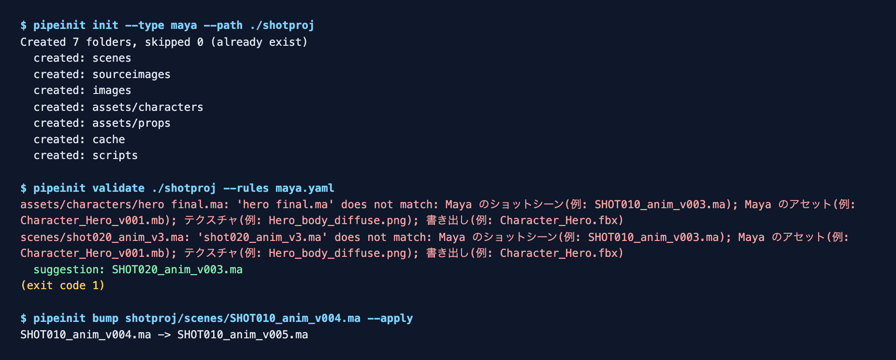
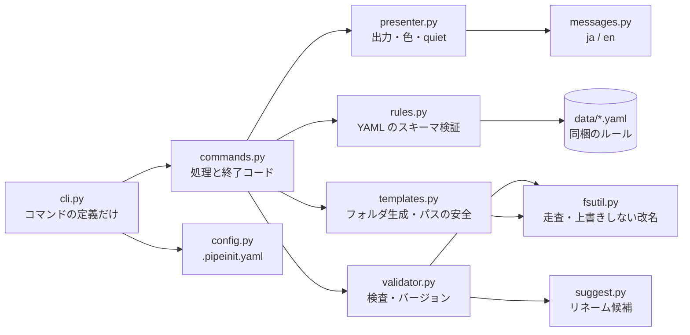

# PipeInit

> **English summary.** PipeInit is a small CLI for CG and game pipelines. `pipeinit init` creates a project folder tree from a rule set (Houdini, Maya, Blender, Unreal, game, film, generic), `pipeinit validate` checks file names against the rule set's regular expressions and suggests a rename for each violation, and `pipeinit bump` increments a version number (dry run by default, never overwrites). Rules are plain YAML with a validated schema; a `.pipeinit.yaml` picks the rules per project. It has JSON output, English and Japanese messages, shell completion, a pre-commit hook and a documented exit-code table. Python 3.11+ on Linux, macOS and Windows.

CG/ゲームパイプライン向けの、プロジェクトフォルダ自動生成・命名規則バリデーション・バージョン採番 CLI。



## できること

| コマンド | 内容 |
| --- | --- |
| `pipeinit init --type <種別>` | ルールセットに従って、フォルダツリーを作る(既存は触らない)。`--houdini-env` で Houdini の `$JOB` のスニペットも書く |
| `pipeinit validate <パス>...` | ファイル名を、ルールの正規表現と照合する。違反には、**リネームの候補**を出す(ファイルは変更しない)。pre-commit から使える |
| `pipeinit bump <ファイル>` | バージョン番号を 1 つ上げる(`v003` → `v004`、`v999` → `v1000`)。既定はドライラン、`--apply` で改名。同名のファイルがあれば、上書きせずに失敗する |
| `pipeinit completion bash\|zsh\|fish` | シェル補完のスクリプトを出す |

種別(`--type`): `houdini` / `maya` / `blender` / `unreal` / `game` / `film` / `generic`

プロジェクトの立ち上げで、フォルダ構成がばらつくこと、`SHOT010_lighting_v003.hip` のような命名規則の違反、バージョン番号の重複・飛びは、現場で最初に問題になる「地味だが全員が困る」領域です。PipeInit は、これを YAML 駆動のルールで、自動化・標準化します。

## インストール

```bash
pipx install pipeinit          # PyPI / TestPyPI への公開後
# いまは、ソースから:
git clone https://github.com/nokgc333/pipeinit.git && cd pipeinit
pip install .                   # 開発用は pip install -e ".[dev]"
pipeinit --version
```

シェル補完:

```bash
eval "$(pipeinit completion bash)"          # bash(~/.bashrc に書く)
eval "$(pipeinit completion zsh)"           # zsh(~/.zshrc に書く)
pipeinit completion fish > ~/.config/fish/completions/pipeinit.fish
```

## 使い方

```bash
# フォルダツリーを作る
pipeinit init --type maya --path ./my-project
pipeinit init --type houdini --path ./my-project --houdini-env   # .pipeinit/houdini.env も書く

# 命名規則の違反を探す(違反あり=終了コード 1)
pipeinit validate ./my-project --rules ./studio_rules.yaml
pipeinit validate ./my-project --json                           # 機械可読の出力
pipeinit validate scenes/a.ma scenes/b.ma                       # ファイルを直接渡してもよい

# バージョンを上げる(既定はドライラン)
pipeinit bump SHOT010_anim_v004.ma
pipeinit bump SHOT010_anim_v004.ma --apply
```

共通のオプション: `--quiet`(補足を抑える)、`--verbose`(詳細を標準エラーに)、`--no-color`(環境変数 `NO_COLOR` でも切れる)、`--lang ja|en`、`--json`(`init` / `validate` / `bump`)。

### 設定ファイル

プロジェクトの `.pipeinit.yaml`(カレントから親フォルダへ探す)と、ユーザー設定(`$XDG_CONFIG_HOME/pipeinit/config.yaml`、Windows は `%APPDATA%\pipeinit\config.yaml`)で、既定を決められる。優先順位は、**オプション > プロジェクト > ユーザー > 同梱の既定**。

```yaml
# .pipeinit.yaml
project_type: maya        # init の --type の既定
rules: studio_rules.yaml  # validate の既定のルール(このファイルからの相対パス)
lang: ja                  # メッセージの言語
```

### pre-commit で使う

```yaml
# .pre-commit-config.yaml
repos:
  - repo: https://github.com/nokgc333/pipeinit
    rev: v0.2.0
    hooks:
      - id: pipeinit-validate
```

コミットするファイルの名前を、`.pipeinit.yaml` の `rules`(なければ同梱の generic)で検査する。

### ルールを自分のスタジオ用に書く

ルールは YAML(`pipeinit/data/*.yaml` が見本)。コードの変更は要らない。

```yaml
schema_version: 1
project_type: studio
folder_template:
  - path: "scenes"
naming_patterns:
  - pattern: '^SHOT\d{3}_[a-z]+_v\d{3}\.(ma|mb)$'
    description: "ショットのシーン(例: SHOT010_anim_v003.ma)"
```

誤りは、どのファイルのどの項目かが分かるエラーになる(例: `naming_patterns[0].pattern is not a valid regular expression`)。

## 終了コード

| コード | 意味 |
| ---: | --- |
| 0 | 成功(違反なし) |
| 1 | 命名の違反あり、またはルールファイルの誤り |
| 2 | 使い方の誤り(引数・オプション) |
| 5 | 書き込めない(権限・作成先) |
| 6 | ルールのパスが、作成先の外を指している |
| 7 | リネーム先に、同名のファイルがある |

`pipeinit --help` の末尾にも、同じ表が出る。

## アーキテクチャ



依存は、左から右の一方向。ファイル操作の安全(上書きしない・シンボリックリンクを辿らない・作成先の外に出ない)は、`fsutil` と `templates` に閉じ込めている。

## FAQ

**違反を自動で直してくれないのはなぜ?** 作業ファイルを、意図せず変えるリスクが大きいため。候補を出すだけにして、改名は人が `mv` する([ADR-0004](docs/adr/0004-suggest-never-rename.md))。`bump` も、既定はドライラン([ADR-0003](docs/adr/0003-dry-run-by-default.md))。

**Maya の `.ma` が違反になる。** `--type maya` のルールセットを使う。Houdini 中心の `game` / `film` は、`.ma` を対象にしていない。

**大きなフォルダでも使える?** ファイルを 1 つずつ走査する(メモリは違反の数に比例)。20 万ファイルで約 10 秒、メモリ 7 MB([計測](docs/performance.md))。`.git` などの隠しフォルダと、シンボリックリンクのフォルダは辿らない。

**Windows で日本語が文字化けする。** コンソールが日本語を表せないときは、表せない文字を `?` にして続ける(落ちない)。`--lang en` で英語のメッセージにできる。

**`$HIP` を設定できない?** Houdini が、開いたシーンの場所から決める組み込みの変数で、環境ファイルでは変えられない(実機で確認、[記録](docs/sample-verification.md))。`$JOB` は設定できる。

**実際の制作での検証は?** Houdini・Maya・Unreal を模したサンプルで、`init` → `validate` → `bump` を動かした記録が [docs/sample-verification.md](docs/sample-verification.md) にある。

## 開発

```bash
pip install -e ".[dev]"
pytest                                   # 230 件、カバレッジ 99%(CI の下限は 95%)
black --check . && isort --check . && flake8 pipeinit tests examples && mypy pipeinit
mutmut run                               # ミューテーションテスト(スコア 88%、CI で週 1 回)
```

貢献の手順は [CONTRIBUTING.md](CONTRIBUTING.md)、文書の一覧は [docs/README.md](docs/README.md)、変更の履歴は [CHANGELOG.md](CHANGELOG.md)。

## Design Decisions

- **正規表現 + YAML 方式。専用パーサー/DSL は自作しない** — 命名規則は文字列パターンの集合で、構文木を要しないため([ADR-0001](docs/adr/0001-regex-and-yaml.md))
- **DB を使わず、YAML を正本とする**([ADR-0002](docs/adr/0002-no-database.md))
- **`bump` は既定でドライラン、`--apply` で明示的にオプトイン。上書きはしない**([ADR-0003](docs/adr/0003-dry-run-by-default.md))
- **違反には、リネームの候補を出すが、自動では直さない**([ADR-0004](docs/adr/0004-suggest-never-rename.md))
- **ルールは、読み込み時にスキーマを検証する。YAML は `yaml.safe_load` のみ**([ADR-0005](docs/adr/0005-rule-schema-validation.md))
- **CLI は、定義・処理・表示・メッセージ・終了コードに分ける**([ADR-0006](docs/adr/0006-module-layout.md))

## 既知の制限事項

- ショットとアセットを、名前の形だけで区別する限界がある(例: `Shot020_anim_v001.ma` は、アセットの規則に合う)。区別が要る場合は、フォルダごとに別のルールファイルを使う
- ルールの正規表現は、利用者が書く(ReDoS になりうる正規表現を書かない運用が前提。ルールは、信頼できるファイルとして扱う)
- `folder_template` は、同一ルールファイル内で完結し、ShotGrid などの外部システムとの同期機能は持たない
- PyPI への公開は、リポジトリの設定(Trusted Publishing)の完了後

## ライセンス

MIT License（[LICENSE](LICENSE)参照）
